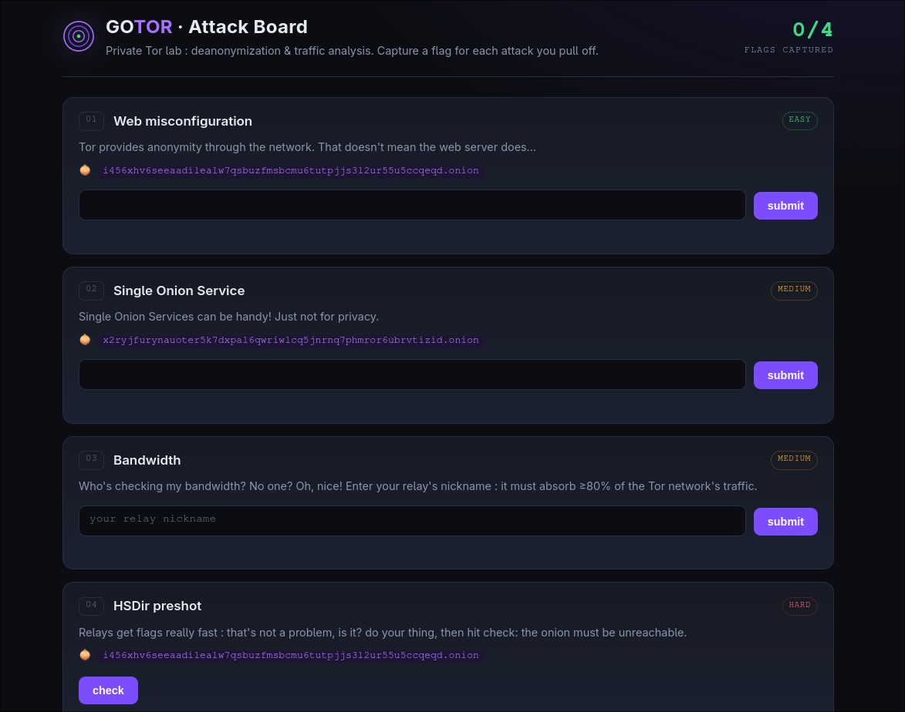

# GOTOR

GOTOR is inspired by [GOAD](https://github.com/Orange-Cyberdefense/GOAD): it provides an on-prem, deliberately vulnerable Tor network. You can spin up a fully configured private Tor network to better understand the Tor protocol.

This lab ships intentional misconfigurations that show how Tor can be deanonymized.


Supported attacks:
* Deanonymize a hidden service through a misconfigured server
* Intercept traffic through a bandwidth attack
* Deanonymize a hidden service running as a Single Onion Service
* Take over a hidden service through a web vulnerability
* DoS a hidden service through an HSDir attack

More to come:
* Deanonymization through a correlation attack
* Bandwidth attack with independent bandwidth measurement enabled
* Guard identification with Vanguards enabled
* Traffic modification on an HTTP site


A blog write-up for each attack is available [here](https://nibi8z.github.io/).

# Installation

This project runs with `podman`.

Arch:
```bash
sudo pacman -S podman docker-compose aardvark-dns netavark
```

Debian/Ubuntu:
```bash
sudo apt install podman docker-compose aardvark-dns netavark
```

# Getting started


```bash
git clone https://github.com/NiBi8z/GOTOR && cd GOTOR
podman compose up -d --build
```


Once started, wait **up to 2-3 minutes** for the lab to fully come up.


Go to **http://localhost:8081** to start the challenges.




Run this command to check that the lab is working:
```bash
podman exec -i client1 python3 -c "
from stem.control import Controller
with Controller.from_port(address='127.0.0.1', port=9051) as c:
    c.authenticate()
    for d in sorted(c.get_network_statuses(), key=lambda x: -x.bandwidth):
        print(f'{d.nickname:<14} bw={d.bandwidth:<7} flags={d.flags}')
"
auth3          bw=357     flags=['Authority', 'Fast', 'HSDir', 'Running', 'Stable', 'V2Dir', 'Valid']
auth1          bw=318     flags=['Authority', 'Fast', 'HSDir', 'Running', 'Stable', 'V2Dir', 'Valid']
middle1        bw=0       flags=['Fast', 'Guard', 'HSDir', 'Running', 'Stable', 'V2Dir', 'Valid']
guard2         bw=0       flags=['Fast', 'Guard', 'HSDir', 'Running', 'Stable', 'V2Dir', 'Valid']
middle5        bw=0       flags=['Fast', 'HSDir', 'Running', 'V2Dir', 'Valid']
guard1         bw=0       flags=['Fast', 'Guard', 'HSDir', 'Running', 'V2Dir', 'Valid']
middle3        bw=0       flags=['Fast', 'Guard', 'HSDir', 'Running', 'Stable', 'V2Dir', 'Valid']
middle2        bw=0       flags=['Fast', 'HSDir', 'Running', 'V2Dir', 'Valid']
middle4        bw=0       flags=['Fast', 'Guard', 'HSDir', 'Running', 'Stable', 'V2Dir', 'Valid']

```
It should list several relays as `Running`.


Tear down the lab to restart from a fresh state:
```bash
podman compose down -v
```

## Topology

This lab contains:

| Role         | Containers                                  |
|--------------|---------------------------------------------|
| DirAuth      | auth1, auth2, auth3                         |
| Guards       | guard1, guard2, guard3                      |
| Middles      | middle1, middle2, middle3, middle4, middle5 |
| Hidden svc   | hs1-leaky, hs2-singlehop                    |
| Clients      | client1, client2                            |
| SOCKS bridge | socks-bridge                                |

The SOCKS bridge proxies `localhost:9050` through the Tor network using `client1`, so you can reach the Tor network from your host.


## Technical details

Using `socks-bridge`, you can reach the Tor network from your host.

**curl**

```bash
curl  --socks5-hostname 127.0.0.1:9050 http://<ONE_LAB_ONION>.onion
<!doctype html>
<html lang="en"><head><meta charset="utf-8">
....
```

**Firefox**

Set the proxy to **SOCKS5**, IP `127.0.0.1`, port `9050`.

In `about:config`, set `network.dns.blockDotOnion` to `false` and `network.proxy.socks_remote_dns` to `true`.

**Anything that supports SOCKS**


### Add a relay to this Tor network

You may want to add a client or a relay (maybe an evil one 👀) to the lab.

Use:
```bash
podman run -d --name <containerName> --network gotor \
  -v gotor_shared:/shared -v "$PWD/torrc:/torrc:ro" \
  -e TOR_ROLE=<client|relay> -e TOR_NICK=<relayName> \
  gotor/node:latest
```

To add a Guard or a Directory Authority for testing, check the settings in `torrc`: everything is documented there.

Feel free to add relays and hidden services, and to try undocumented attacks. This lab is essentially a containerized Tor network that makes it easy to spin up Tor relays.

### Relay status

In this lab, all relays are assumed to be reachable. If a relay is started and then shut down, it stays in the consensus. To disable this behavior:
```bash
for ctr in auth1 auth2 auth3; do
  podman exec -i "$ctr" python3 -c "
from stem.control import Controller
with Controller.from_port(address='127.0.0.1', port=9051) as c:
    c.authenticate()
    c.set_conf('AssumeReachable', '0')
    print(c.get_conf('Nickname'), '-> AssumeReachable =', c.get_conf('AssumeReachable'))
"
done
```
A stopped relay still takes up to 45 minutes to leave the consensus.


## Lab timing

This Tor network rotates much faster than the real Tor network (so you don't have to wait **an hour** after adding a relay).

Timings to keep in mind when using this lab:

| Item | This lab | Real Tor |
|---|---|---|
| Voting interval | **60 s** | 1 h |
| Consensus "fresh" | **1 min** | 1 h |
| Consensus valid | **3 min** | 3 h |
| First vote | 20 s | - |
| **HSDir period** | **24 min** | 1440 min (24 h) |
| Period offset | **12 min** | 720 min (12 h) |
| **SRV rotation** | ~1 per shared-random run (~20-25 min) | 1 / day |
| HSDir flag | **all relays** | earned (uptime) |
| Guard flag | **guard1/2/3 only** | earned |
| Reachability | **assumed** | tested |